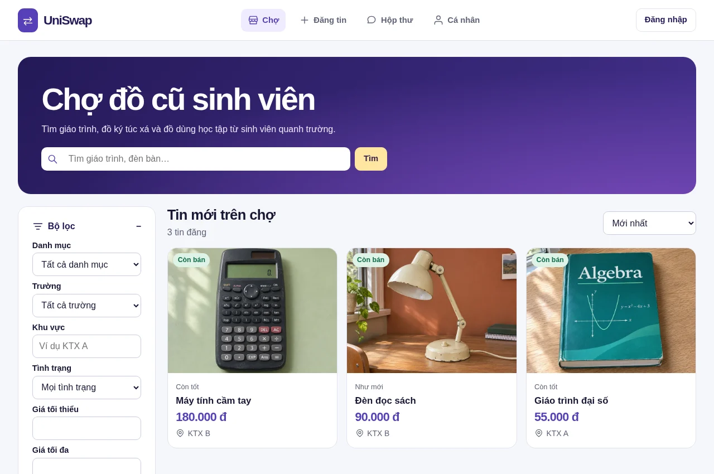

# UniSwap · Chợ đồ cũ sinh viên

UniSwap giúp sinh viên tìm và trao đổi giáo trình, đồ ký túc xá, thiết bị học tập trong khu vực quanh trường: nhắn tin, giữ món, hẹn nhận, đánh giá hai chiều, quản trị tin. Bài tập lớn của **HBX Team**.



Stack: Next.js + TypeScript (frontend) · NestJS + Prisma + PostgreSQL (backend) · Mailpit (mail dev) · Docker Compose.

## Chạy demo (Docker, Linux/WSL)

```bash
bash agent/env.sh up
docker compose build api
docker compose run --rm api npm run db:migrate
docker compose run --rm api npm run db:seed
docker compose up -d --wait
```

App: http://127.0.0.1:3000 · API health: http://127.0.0.1:3001/api/v1/health · Mailpit: http://127.0.0.1:58025. Mật khẩu mẫu: `UniSwapDemo123!` (`minh@`, `lan@`, `an@`, `admin@`, `chua-xac-minh@student.example.test`).

## Triển khai demo trên EC2 với Nginx

Trên EC2 mới dùng Amazon Linux, chạy Docker Compose theo mục trên. Trỏ bản ghi DNS `A` của `uniswap.socodo.space` về IPv4 public của EC2 và mở cổng `80`, `443` trong Security Group. Nếu dùng tên miền khác, thay tên miền trong mẫu và các lệnh bên dưới.

```bash
sudo dnf install -y nginx
sudo install -m 0644 deploy/nginx/uniswap.conf /etc/nginx/conf.d/uniswap.conf
sudo nginx -t && sudo systemctl enable --now nginx && sudo systemctl reload nginx
```

Mẫu HTTP chuyển yêu cầu tới Next.js trên `127.0.0.1:3000`. Trên máy đã có HTTPS, giữ cấu hình Certbot đang dùng để bảo toàn các dòng TLS.

Sau khi DNS có hiệu lực, dùng Certbot với plugin Nginx để cấp chứng chỉ và chuyển hướng HTTP sang HTTPS.

```bash
sudo certbot --nginx -d uniswap.socodo.space --redirect
```

Nếu cài Certbot trong `/opt/certbot`, dùng `sudo /opt/certbot/bin/certbot`. Đặt `APP_ORIGIN=https://uniswap.socodo.space` trong `.agent-run/local.env`, chạy `docker compose up -d --wait` và kiểm tra bằng `curl -fsS https://uniswap.socodo.space/api/v1/health`. Bật lịch tự gia hạn và thử bằng `certbot renew --dry-run` với đường dẫn Certbot tương ứng.

### Cập nhật bản đang chạy trên EC2

Sau khi cài Docker Compose, khởi tạo `.agent-run/local.env` và đặt `APP_ORIGIN` thành địa chỉ web đang dùng, chạy lệnh sau từ bản clone `main` sạch trên EC2.

```bash
bash scripts/deploy.sh
```

Script cập nhật từ `origin/main`, bật PostgreSQL và Mailpit, build image, áp dụng migration rồi chạy web và API. Khi Compose khởi động thành công, smoke test kiểm tra API health, trang chủ và route riêng tư qua địa chỉ `APP_ORIGIN`. Có thể chạy riêng bằng `bash scripts/smoke.sh https://uniswap.socodo.space`.

## Phát triển local

```bash
bash agent/env.sh up          # Postgres + Mailpit (chạy được cả macOS/Windows Git Bash)
set -a; source .agent-run/local.env; set +a
npm ci && npm run db:generate && npm run db:migrate && npm run db:seed
npm run dev                   # web :3000 + API :3001, Ctrl+C tắt cả hai
```

Cổng mặc định: 3000 web, 3001 API, 55432/55433 Postgres, 51025/58025 Mailpit. Nếu cổng bị chiếm, dừng tiến trình đang dùng trước. Bản Docker đóng gói (`compose.yaml`) dùng `network_mode: host` nên chỉ chạy trên Linux/WSL; macOS/Windows chạy web/API bằng Node như trên.

## Kiểm thử

```bash
set -a; source .agent-run/local.env; set +a
export PLAYWRIGHT_BROWSERS_PATH="$PWD/.agent-run/browsers"
npx playwright install chromium
export DATABASE_URL="$TEST_DATABASE_URL" NODE_ENV=test CI=true
export ACCEPTANCE_EVIDENCE_DIR="$PWD/.agent-run/evidence/local"
bash agent/acceptance.sh && python3 agent/check.py evidence "$ACCEPTANCE_EVIDENCE_DIR"
```

Bộ nghiệm thu gồm lint, typecheck, build, 53 thao tác HTTP theo OpenAPI, luồng trình duyệt Chromium và kiểm tra seed lặp lại. Cần Python 3. Nếu thiếu thư viện Chromium, chạy `npx playwright install --with-deps chromium`.

## AI review pull request

Workflow [`.github/workflows/ai-review.yml`](.github/workflows/ai-review.yml) gọi DeepSeek khi PR mở/cập nhật và cập nhật một comment review (tiếng Việt theo template báo cáo). Cần secret `DEEPSEEK_API_KEY`; tuỳ chọn variable `DEEPSEEK_MODEL` (mặc định `deepseek-chat`) và `DEEPSEEK_BASE_URL`. Thiếu secret không làm đỏ PR. `ci.yml` vẫn là gate bắt buộc.

## Tài liệu

| Cần tìm | Tài liệu |
|---|---|
| Yêu cầu, nghiệp vụ, kế hoạch | [Use case](docs/nghiep-vu.md) · [Kế hoạch](docs/ke-hoach.md) · [Báo cáo gốc](docs/Bao_cao_thao_luan_nhom_HBX_Team_cho_do_cu_sinh_vien.docx) |
| Kiến trúc, ERD, dữ liệu | [Kiến trúc](docs/kien-truc.md) · [ERD](docs/du-lieu.md) · [Luồng UI](docs/design/ui.md) |
| API | [docs/api.md](docs/api.md) · [openapi.yaml](docs/openapi.yaml) |
| Nghiệm thu | [docs/nghiem-thu.md](docs/nghiem-thu.md) |
| Triển khai cloud | [Vercel, Neon và kho ảnh](docs/trien-khai-vercel.md) |
| Mã nguồn | [frontend/README.md](frontend/README.md) · [backend/README.md](backend/README.md) |

Codex (tùy chọn) điều phối agent AI qua `agent/run.sh`; các bước chạy app/test độc lập với runner AI. Dừng dịch vụ: `Ctrl+C` (dev), `docker compose stop` (Docker), `bash agent/env.sh stop` (DB + Mailpit). Dữ liệu và ảnh giữ trong volume.
