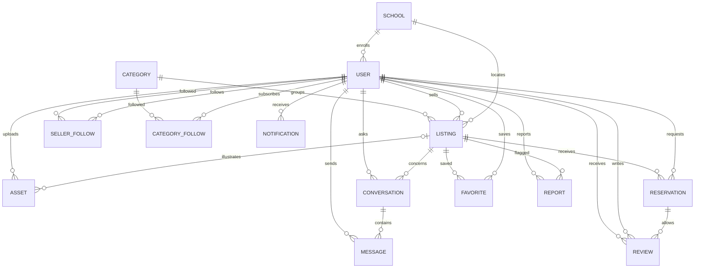

# Mô hình dữ liệu

## ERD các quan hệ nghiệp vụ

## Từ điển cho người viết migration

Các bảng thực thể dùng UUID làm khóa chính id, thời điểm dùng timestamptz. Mỗi cột kết thúc bằng Id tham chiếu khóa chính của bảng tương ứng. Các bảng liên kết dùng khóa ghép ở cột đầu. Dấu ? biểu thị cho phép null.

| Bảng | Trường chính ngoài id | Ràng buộc hoặc mục đích |
|---|---|---|
| School | name, code | code duy nhất. Seed vài trường minh họa. Khu vực/KTX là văn bản ngắn cho MVP |
| User | email, passwordHash?, googleSub?, displayName, schoolId?, area?, contact?, role, status, verifiedAt?, lastActiveAt?, createdAt | Email chuẩn hóa chữ thường duy nhất, googleSub duy nhất nếu có. role STUDENT/ADMIN, status ACTIVE/LOCKED. verifiedAt rỗng nếu chưa xác thực |
| VerificationToken, Session | userId, expiresAt, tokenHash (xác thực) hoặc revokedAt? (phiên) | Token xác thực một lần. Session.id là sessionId trong JWT. Hủy phiên khi khóa hoặc đăng xuất |
| Category | name, active | Tên duy nhất, đánh dấu ngừng dùng thay cho xóa khi đã có tin |
| Listing | sellerId, categoryId, schoolId, area, title, description, price, condition, state, moderation, publishedAt?, createdAt, updatedAt | Giá nguyên VND từ 0 đến 2 tỷ. condition LIKE_NEW/GOOD/FAIR. state AVAILABLE/RESERVED/SOLD/HIDDEN, moderation APPROVED/PENDING/REMOVED |
| Asset | ownerId, purpose, objectKey, mime, bytes, listingId?, position? | purpose LISTING hoặc PAYMENT_QR. Khóa kho ảnh duy nhất. Vị trí 0 là ảnh bìa. Ảnh QR dùng quyền truy cập riêng |
| Conversation | listingId, buyerId, createdAt | Unique(listingId,buyerId). Người bán suy ra từ tin và không thay đổi |
| Message | conversationId, senderId, text, createdAt | Người gửi là thành viên hội thoại. Index (conversationId,createdAt,id) |
| Reservation | listingId, buyerId, state, finalPrice?, meetingAt?, meetingPlace?, paymentMethod?, qrAssetId?, createdAt, completedAt? | Thông tin chốt chỉ bắt buộc lúc ACCEPT. paymentMethod COD/QR_MANUAL. qrAssetId tham chiếu Asset thuộc người bán khi QR_MANUAL |
| Review | reservationId, authorId, targetId, rating, comment?, createdAt | Unique(reservationId,authorId), target là đối tác. CHECK rating 1–5, authorId khác targetId |
| Favorite, SellerFollow, CategoryFollow | (userId,listingId), (userId,sellerId), (userId,categoryId) | PK từng cặp, không tự theo dõi. Bật/tắt lặp lại được |
| Notification | userId, kind, resourceId, eventKey, readAt?, createdAt | kind MESSAGE/RESERVATION/NEW_LISTING/MODERATION. Unique(userId,eventKey) chống gửi trùng một sự kiện |
| Report | reporterId, listingId, reason, details?, state, createdAt, resolvedAt?, resolvedById?, resolutionNote? | reason SCAM/PROHIBITED/SPAM/OTHER. state OPEN/DISMISSED/ACTIONED. Tối đa một báo cáo OPEN mỗi người mỗi tin |
| ModerationLog | adminId, targetType, targetId, action, reason, createdAt | Nhật ký append-only cho quyết định kiểm duyệt, khóa và mở khóa. Từ khóa cấm là danh sách cấu hình server, có bộ mẫu cho demo |

## Các bất biến và truy vấn

- Tìm kiếm công khai mặc định chỉ lấy AVAILABLE, APPROVED của người bán ACTIVE. URL chi tiết có thể xem RESERVED và SOLD nếu vẫn được duyệt. HIDDEN, REMOVED, PENDING hoặc người bán bị khóa chỉ hiển thị cho chủ thể có quyền qua trang riêng. Hàng đang hẹn giữ snapshot giá và lịch trong Reservation.
- Công khai lần đầu đặt publishedAt và ghi thông báo cho hợp của hai tập người theo dõi, bỏ chính chủ tin. Duyệt lại và hiện lại dùng cùng publishedAt. Một notification liên kết tài nguyên chỉ được mở nếu người đọc còn quyền.
- Index Listing(moderation,state,schoolId,createdAt), Listing(categoryId,price) và Reservation(buyerId,createdAt). Tìm theo từ khóa bằng phép so khớp không phân biệt hoa thường trên tiêu đề/mô tả, giữ dấu tiếng Việt ở bản đầu. Sắp xếp ổn định bằng id khi trùng khóa sort.
- Tạo index unique có điều kiện trên reservation(listing_id) khi state = 'ACCEPTED', và trên (listing_id,buyer_id) khi state = 'PENDING'. Dùng migration SQL nếu công cụ sinh schema chưa biểu đạt được điều kiện. Các luồng tạo, chấp thuận, hủy, hoàn tất hoặc đóng tin đều khóa hàng Listing trước khi kiểm tra trạng thái. [PostgreSQL partial indexes](https://www.postgresql.org/docs/current/indexes-partial.html)
- Gỡ tin hủy mọi giữ hàng còn mở, lưu nhật ký và thông báo cùng transaction. Khóa sinh viên thu hồi phiên và hủy yêu cầu PENDING/ACCEPTED của họ ở cả hai vai trò. Giải phóng tin RESERVED khi hẹn bị hủy. Khi khóa đồng thời với giữ hàng, đồng bộ thay đổi trên người mua/người bán và các tin liên quan theo thứ tự id cố định. Mở khóa không khôi phục lịch đã hủy.
- Thống kê admin nhận khoảng thời gian [from,to). Đếm tin theo createdAt, giao dịch hoàn tất theo completedAt, sinh viên hoạt động theo lastActiveAt nằm trong khoảng (thời điểm truy cập có xác thực gần nhất). Đây là số người có **lần hoạt động gần nhất** trong kỳ. Muốn làm báo cáo lịch sử chính xác theo ngày cần lưu sự kiện hoạt động theo ngày.
- Điểm uy tín là trung bình rating nhận được làm tròn một chữ số thập phân, kèm tổng lượt. Không có đánh giá trả averageRating=null và reviewCount=0.
