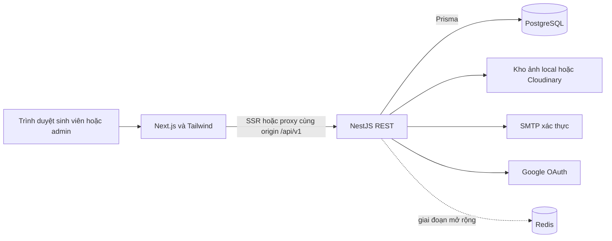
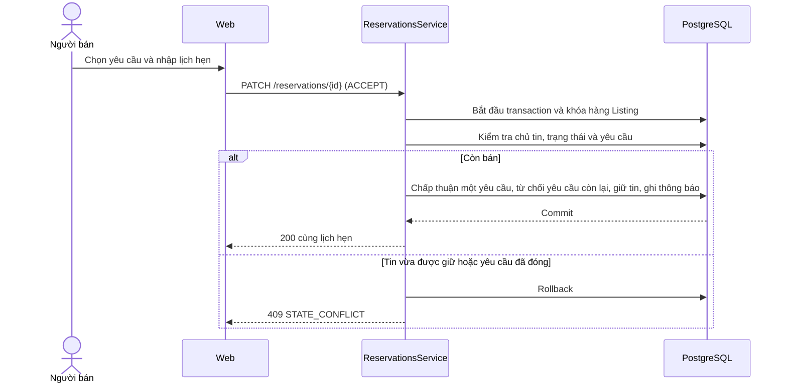

# Kiến trúc và lựa chọn công nghệ

## Các thành phần

Đề xuất chạy một frontend và một backend chia module. Với một nhóm sinh viên, người viết module giữ hàng có thể cập nhật tin, lịch hẹn và thông báo trong cùng giao dịch SQL. Cách này cũng cho phép demo chỉ với một DB. Đặt logic nghiệp vụ ở NestJS để giao diện di động, web và kiểm thử HTTP dùng cùng quy tắc.

| Thành phần báo cáo mục IV | Chọn cho nhóm | Cách sử dụng |
|---|---|---|
| TypeScript, Next.js (React), Tailwind CSS | Giữ | App Router cho danh sách, chi tiết và hồ sơ. SSR trang công khai để liên kết tin mở trực tiếp và có tiêu đề riêng. [Next.js App Router](https://nextjs.org/docs/app) |
| TypeScript, NestJS, REST, JWT | Giữ | Một tiến trình API. Mỗi nghiệp vụ có controller/service riêng. Guard kiểm tra phiên và quyền, service kiểm tra quyền trên từng bản ghi. [NestJS modules](https://docs.nestjs.com/modules) |
| PostgreSQL, Prisma | Giữ | DB lưu tin, yêu cầu giữ, chat, đánh giá, trạng thái đã đọc. Transaction đảm bảo một món chỉ được nhận giữ một lần. [Prisma transactions](https://www.prisma.io/docs/orm/fundamentals/transactions) |
| Redis | Để sau mốc giao dịch | Một máy demo có thể tải tin nhắn/thông báo mới bằng polling 5 giây khi tab mở. Khi cần đẩy ngay giữa nhiều instance, bổ sung WebSocket và Redis Pub/Sub, vẫn lưu lịch sử ở DB. |
| SMTP, Google OAuth | Email ở mốc 1, Google ở mốc 3 | SMTP local cho demo, SMTP thật khi triển khai. Kiểm tra miền và email_verified khi dùng Google. |
| Cloudinary hoặc S3 | Local khi phát triển, đề xuất Cloudinary khi đưa lên mạng | Dùng một giao diện lưu ảnh. DB giữ khóa lưu trữ, URL, kích thước và chủ sở hữu ảnh. |
| VietQR/PayOS, GHN | COD gặp tại trường trước, QR do người bán cung cấp ở mốc 3 | Hai bên tự đối soát. Cổng đối soát tự động và vận đơn GHN có thể phát triển sau. |
| Docker, GitHub Actions, VPS/cloud | Dùng khi đã dựng được hai app | Compose cho môi trường nhóm. CI dùng database test, chạy lint, typecheck, migration, test, build. Một VPS là phương án triển khai được đề xuất trong báo cáo. |

## Luồng xác nhận giữ

## Chạy local và triển khai dự kiến

| Dịch vụ | Thiết lập khi bắt đầu code | Kiểm tra khi ghép hệ thống |
|---|---|---|
| Web | Cổng 3000, API qua đường dẫn cùng origin /api/v1 | Mở link tin từ cửa sổ ẩn danh, có HTML tiêu đề và giá. Trang riêng tư không cache dùng chung |
| API | Cổng nội bộ 3001, đường dẫn gốc /api/v1 | GET /health trả 200 khi kết nối được DB, trả 503 khi DB chưa sẵn sàng |
| DB | PostgreSQL với volume, DATABASE_URL, tách database demo/test | Chạy migration và seed từ dữ liệu rỗng. Backup trước migration khi đã có dữ liệu |
| Xác thực | JWT_SECRET, APP_ORIGIN, STUDENT_EMAIL_DOMAINS, SMTP_URL, GOOGLE_CLIENT_ID, GOOGLE_CLIENT_SECRET, GOOGLE_REDIRECT_URI | Mở thư local, xác thực một lần. Callback kiểm tra state, issuer, audience, email đã xác thực và đúng miền. Ràng buộc tài khoản qua subject Google và email trường đã xác thực |
| Ảnh | UPLOAD_DIR với volume local hoặc thông tin xác thực kho ảnh | Chỉ nhận JPEG/PNG/WebP đúng định dạng thực, tối đa 5 MiB mỗi ảnh. Kiểm tra chủ ảnh khi gắn vào tin hoặc lịch hẹn QR |
| Triển khai | Proxy HTTPS chuyển /api về NestJS, đường dẫn còn lại về Next.js. Secrets qua môi trường CI/VPS | Migration chạy một lần trước mở lưu lượng. Kiểm tra /health, đăng nhập và tải ảnh sau khởi động lại |

Phiên dùng JWT trong cookie HttpOnly, SameSite=Lax, Secure khi chạy HTTPS. Route ghi kiểm tra Origin cho client web. JWT có thời hạn đề xuất 2 giờ, mang sessionId, guard đối chiếu phiên và trạng thái tài khoản để đăng xuất/khóa có tác dụng ngay. Hash mật khẩu bằng Argon2id, chỉ lưu hash token xác minh, giới hạn tần suất đăng nhập, gửi thư, nhắn tin và tải ảnh. Chỉ chủ tài khoản đọc được trường contact qua /me. Hai bên liên lạc qua chat. Ảnh QR chỉ trả cho chủ ảnh và người mua của lịch hẹn ACCEPTED hoặc COMPLETED gắn với ảnh đó. Loại secrets, mật khẩu, token và nội dung chat khỏi log vận hành.

SEO, hiệu năng và bảo mật ở mục V được đánh giá qua ca KT11–KT12 trong [kịch bản nghiệm thu](nghiem-thu.md). Nhóm điền kết quả đo trên máy demo sau khi có ứng dụng.
