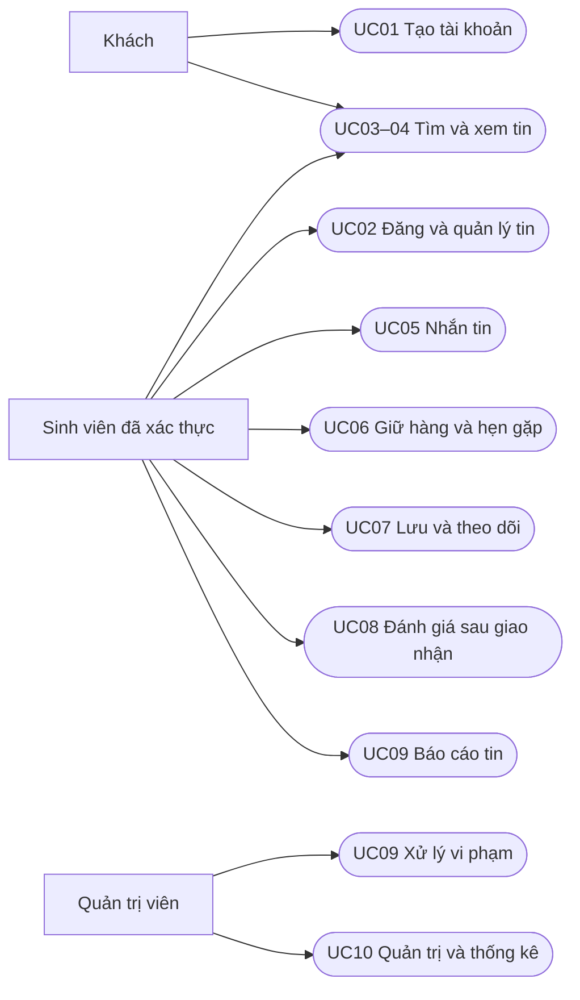
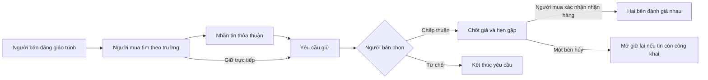
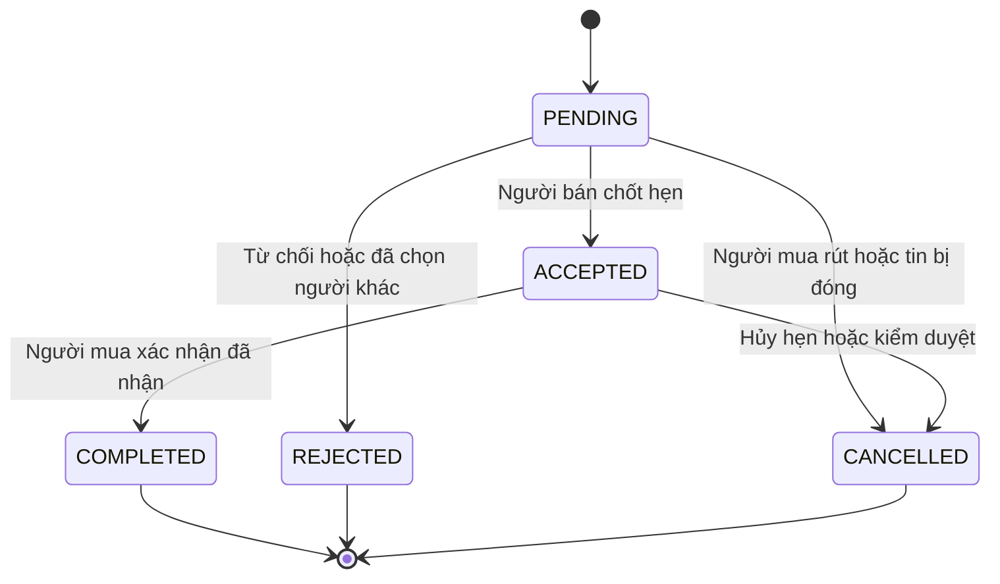

# Nghiệp vụ chợ đồ cũ sinh viên

## Căn cứ và phạm vi

Mục I của [báo cáo HBX Team](Bao_cao_thao_luan_nhom_HBX_Team_cho_do_cu_sinh_vien.docx) đặt tên UniSwap. Mục II dùng thêm tên HBX Market và ghi nhận ý tưởng còn tạm thời. Thiết kế này dùng UniSwap. Mỗi tin đại diện cho một món hoặc một combo bán nguyên bộ. Cùng một sinh viên có thể bán giáo trình hôm nay và mua đèn học ngày mai. Vì vậy nút “Giữ món” nằm ở trang chi tiết từng tin. Việc gom hàng của nhiều người bán vào giỏ sẽ làm phức tạp lịch hẹn mà báo cáo yêu cầu.

Mục III là nguồn của UC01–UC10. Mục IV là nguồn chọn công nghệ. Mục V phân công nghiên cứu, kỹ thuật và báo cáo học phần. Doanh thu quảng cáo, tin nổi bật, chương trình ra trường và bài phân tích thị trường ở mục II/V thuộc phần trình bày hoặc phát triển sau. Việc cho phép khách xem tin, cách chọn người được giữ và quy tắc xác nhận dưới đây là đề xuất triển khai.

## Tác nhân và quyền

| Tác nhân | Có thể làm gì |
|---|---|
| Khách | Duyệt danh mục, tìm kiếm, xem tin công khai và điểm uy tín, đăng ký hoặc đăng nhập |
| Sinh viên đã xác thực | Quản lý hồ sơ của mình, đăng và quản lý tin của mình, hỏi mua tin của người khác, lưu/theo dõi, báo cáo |
| Người mua trong một giao dịch | Gửi hoặc hủy yêu cầu giữ, xem lịch hẹn, xác nhận đã nhận, đánh giá người bán |
| Người bán trong một giao dịch | Chấp thuận hoặc từ chối yêu cầu cho tin của mình, chốt giá và lịch hẹn, hủy hẹn, đánh giá người mua |
| Quản trị viên | Kiểm tra tin bị gắn cờ hoặc báo cáo, gỡ tin, khóa/mở tài khoản sinh viên, quản lý danh mục và xem thống kê |

## Sơ đồ tác nhân và chức năng

## Use case và tiêu chí chấp nhận

| Mã và tính năng mục III | Điều kiện và thao tác chính | Kết quả quan sát được và ngoại lệ |
|---|---|---|
| UC01 · Tài khoản và hồ sơ | Khách nhập email đúng miền trường và mật khẩu, mở thư xác thực rồi đăng nhập. Có thể dùng Google với email trường đã xác thực. Sinh viên sửa tên, trường, KTX và liên hệ. | Chỉ phiên hợp lệ mới đăng tin. Link hết hạn có thể gửi lại. Google email ngoài miền bị từ chối. Hồ sơ công khai chỉ hiện tên, trường và uy tín. |
| UC02 · Đăng và quản lý tin | Chủ tin tải 1–6 ảnh, điền tiêu đề, mô tả, giá VND, tình trạng, danh mục, trường và khu vực. Có thể sửa, ẩn, hiện lại hoặc đánh dấu đã bán trực tiếp. | Tin hợp lệ xuất hiện sau khi qua kiểm tra từ khóa. Tin chờ duyệt có trạng thái riêng trên “Tin của tôi”. Người khác sửa tin bị từ chối. |
| UC03 · Tìm và lọc | Khách nhập từ khóa, chọn danh mục, trường, KTX/khu vực, khoảng giá và tình trạng. | Kết quả thỏa đồng thời các bộ lọc. Có phân trang, xóa lọc và trạng thái rỗng. Khoảng giá đảo chiều trả lỗi nhập liệu. |
| UC04 · Chi tiết tin | Khách mở đường dẫn trực tiếp, xem ảnh, giá, tình trạng, địa điểm, uy tín và hồ sơ người bán. | Tin đang giữ/đã bán có nhãn và ngừng nhận yêu cầu mới. Tin ẩn/chờ duyệt/gỡ trả 404 với người ngoài. |
| UC05 · Nhắn tin | Người mua mở hội thoại theo tin, hai bên nhắn để chốt giá và hẹn sơ bộ. | Cặp người mua–tin dùng lại cùng hội thoại. Có thông báo tin nhắn mới. Người ngoài không xem được lịch sử. |
| UC06 · Giữ và giao nhận | Người mua gửi yêu cầu. Người bán chọn một yêu cầu, nhập giá đã thống nhất, giờ, địa điểm gặp và COD hoặc QR thủ công. Người mua xác nhận đã nhận món. | Một món chỉ được giữ cho một người tại một thời điểm. Khi hoàn tất, món chuyển đã bán. Hủy hẹn cho phép món mở lại khi vẫn đủ điều kiện hiển thị. |
| UC07 · Lưu và theo dõi | Sinh viên bấm lưu tin, theo dõi người bán hoặc đăng ký danh mục. Có thể bỏ từng lựa chọn. | Trang đã lưu phản ánh thao tác sau tải lại. Khi tin lần đầu được đăng công khai, người theo dõi nhận một thông báo dù theo cả danh mục lẫn người bán. |
| UC08 · Uy tín hai chiều | Sau khi hoàn tất, mỗi bên chấm bên kia từ 1–5 sao và có thể để lại nhận xét. | Điểm và số lượt đánh giá xuất hiện trên hồ sơ. Mỗi bên chỉ chấm một lần mỗi giao dịch. Chưa có lượt thì hiện “Chưa có đánh giá”. |
| UC09 · Báo cáo và kiểm duyệt | Sinh viên chọn lý do báo cáo tin. Nội dung khớp danh sách từ khóa bị đưa vào hàng chờ. Admin duyệt/gỡ tin, xử lý báo cáo hoặc khóa tài khoản. | Người dùng thấy kết quả theo quyền. Gỡ tin đang hẹn hủy giao dịch liên quan và báo hai bên. Quyết định quản trị lưu người thực hiện và lý do. |
| UC10 · Quản trị | Admin xem danh sách tài khoản/tin, tạo hoặc đổi tên, ngừng dùng danh mục và xem số liệu. | Sinh viên truy cập bị chặn. Ngừng danh mục giữ được lịch sử và chặn chọn danh mục đó cho tin mới. Số liệu có định nghĩa ở tài liệu dữ liệu. |

## Luồng giao dịch

## Vòng đời yêu cầu giữ

- Sinh viên đã xác thực gửi giữ trên tin còn bán của người khác, kể cả trước khi mở chat. Cùng người mua gửi lại hoặc gửi đồng thời khi còn PENDING nhận lại cùng một yêu cầu. Hai người mua khác nhau có thể cùng chờ. Người mua rút yêu cầu đang chờ thành CANCELLED, người bán từ chối thành REJECTED.
- Người bán chốt một yêu cầu trong transaction. Server khóa tin, kiểm tra quyền, tin còn AVAILABLE và đã duyệt, đổi tin sang RESERVED và từ chối các yêu cầu PENDING còn lại. Cạnh tranh mất lượt trả 409 để UI tải lại.
- Hai bên xem giá chốt và lịch hẹn trong giao dịch. Muốn đổi lịch đã xác nhận, hai bên thống nhất qua chat, một bên hủy rồi người mua tạo yêu cầu mới. Lịch đã hủy giữ giá, giờ, địa điểm và phương thức thanh toán trong lịch sử. Trang giao dịch ngừng hiển thị ảnh QR của lịch đó. Người bán kiểm tra tiền mặt/chuyển khoản khi gặp. QR thủ công không phát sinh trạng thái “ngân hàng đã thanh toán”.
- Người mua xác nhận nhận món một lần, hệ thống ghi COMPLETED và SOLD cùng transaction. Lịch sử và đánh giá có thể mở lại từ “Giao dịch của tôi”. Bán ngoài hệ thống dùng “Đánh dấu đã bán”, không tạo giao dịch hay quyền đánh giá.
- Chủ tin chỉ sửa/ẩn/đánh dấu bán khi AVAILABLE và chưa bị gỡ. Khi ẩn, bán ngoài hoặc sửa khiến tin quay về chờ duyệt, hủy yêu cầu đang chờ. Hủy hẹn thông thường mở lại AVAILABLE. Gỡ tin/khóa tài khoản còn áp dụng điều kiện hiển thị độc lập. Báo cáo đã xử lý và nhận xét đã tạo được giữ làm lịch sử.
